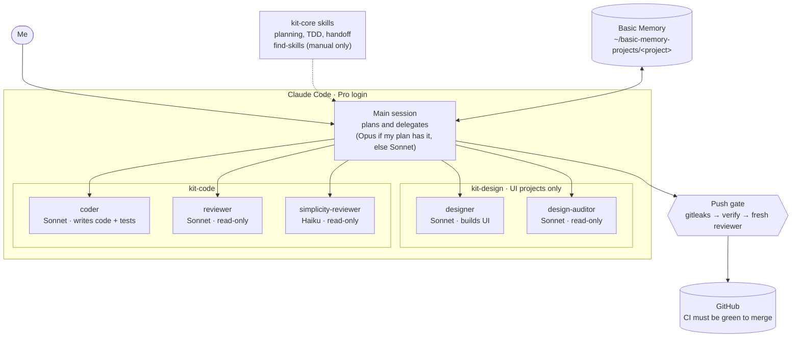
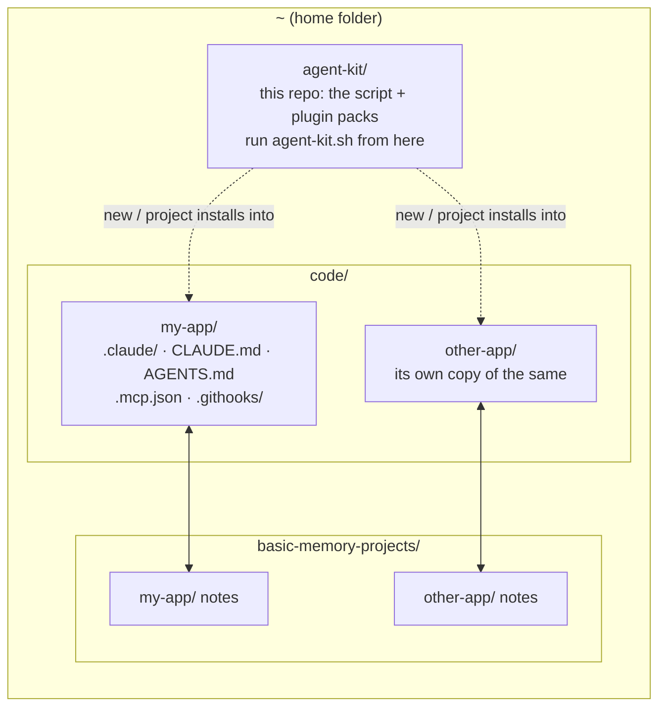
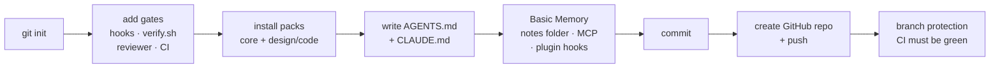
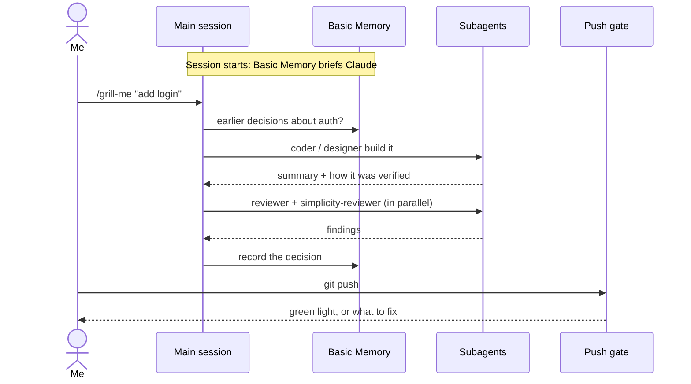
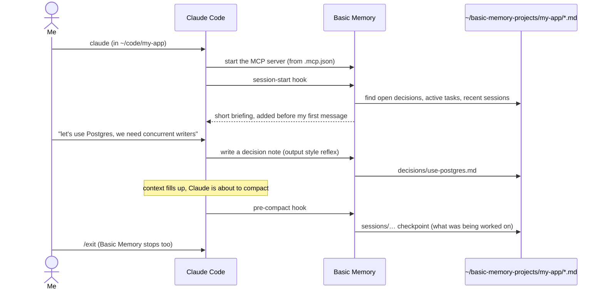
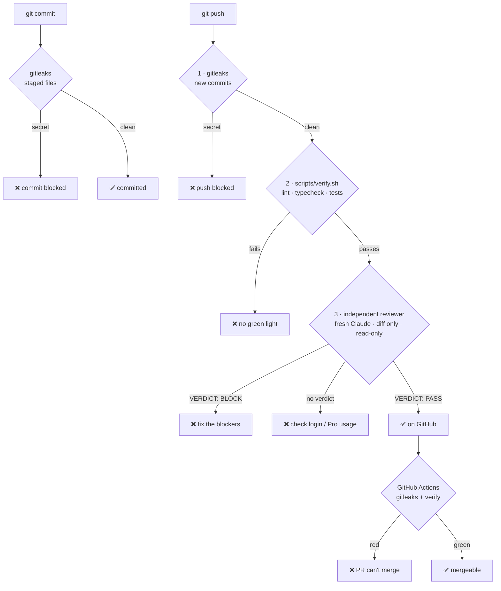

# agent-kit

My personal Claude Code setup. One script, `agent-kit.sh`, turns any folder into a project that:

- runs entirely on my **Claude Pro** login (no API key, no other AI accounts)
- delegates work to small, cheap **subagents** instead of doing everything in one big session
- **remembers** decisions between sessions with Basic Memory
- can't push code that leaks a secret, fails its tests, or fails an **independent review**

This repo is also a Claude Code plugin marketplace. The `plugins/` folder holds the three packs the script installs.

---

## How it fits together



| Piece | What it is | Where it lives |
|---|---|---|
| **Main session** | The Claude Code session I talk to. It plans and hands work to subagents. | my terminal |
| **Subagents** | Specialists with their own instructions, tools and model. Each starts with a clean context, so they're cheap. | `plugins/kit-*/agents/*.md` |
| **Skills** | Reusable know-how (how to do TDD, how to use shadcn…). Only the one-line description loads until a skill is used. | the plugins and their dependencies |
| **Packs** | `kit-core` (always), `kit-design` (frontend projects), `kit-code` (any code). | installed per project |
| **AGENTS.md / CLAUDE.md** | The project's rules. `CLAUDE.md` imports `AGENTS.md` and adds a short note on which agent to use for what. | in each project |
| **Basic Memory** | Long-term memory: plain Markdown notes Claude reads and writes through an MCP server. | `~/basic-memory-projects/<project>` |
| **Push gate** | Git hooks plus GitHub Actions that block bad pushes and merges. | `.githooks/`, `scripts/`, `.github/` |

---

## One-time setup (per machine)

1. **Get the kit and install everything it needs.** `setup` installs git, Python, Claude Code, gitleaks, uv (for Basic Memory), the GitHub CLI and Node with Homebrew on macOS or apt/dnf on Linux and WSL. It skips anything already installed and upgrades a gitleaks that's too old.

   ```bash
   git clone https://github.com/milosanokklis-debug/new_ai_setup ~/agent-kit
   cd ~/agent-kit
   ./agent-kit.sh setup
   ```

   On a Mac without Homebrew, `setup` stops and prints the one-line Homebrew install command. If it says to add `~/.local/bin` to my PATH, I add that line to `~/.zshrc` and open a new terminal.

2. **Sign in with my Pro plan, not an API key.**

   ```bash
   unset ANTHROPIC_API_KEY      # also remove it from ~/.zshrc if it's there
   claude                       # log in with my claude.ai account, then type /status to confirm
   gh auth login                # so the script can create GitHub repos
   ```

   If `ANTHROPIC_API_KEY` is set, Claude Code uses it instead of Pro and bills the API. `setup` warns me if it's set.

3. **Register the marketplaces:**

   ```bash
   ./agent-kit.sh register .
   echo 'export KIT_REPO=milosanokklis-debug/new_ai_setup' >> ~/.zshrc
   ```

   Registering only adds catalogs. Nothing loads into Claude until a project installs a pack.

---

## Where things live

Projects go **next to** the kit, never inside it. The script refuses to create a project inside the kit folder.



**Always start Claude inside the project's folder** (`cd ~/code/my-app && claude`). Which agents, skills, rules and Basic Memory notes Claude uses is decided by the folder it starts in. Started from the kit folder or my home folder, Claude has none of the project's setup.

Having lots of projects doesn't cost context. Claude Code reads files only when it needs them, and each project only sees its own packs and its own notes.

---

## Starting a new project

```bash
./agent-kit.sh new ~/code/my-app design code          # private GitHub repo
./agent-kit.sh new ~/code/my-app code --public        # public (needed for branch protection on a free plan)
./agent-kit.sh new ~/code/my-app code --no-github     # local only, push later with: ./agent-kit.sh repo ~/code/my-app
```

Leave out `design` for projects with no UI. Leave out `code` for projects with no code.



Then:

```bash
cd ~/code/my-app && claude
```

The first time, Claude Code asks me to approve the `basic-memory` server. I say yes. From then on it starts by itself every session.

To add the kit to a project that already exists, use `./agent-kit.sh project <path> design code` (no repo changes), or `./agent-kit.sh repo <path>` to add only the gates.

---

## Working day to day



- **Start a feature** with `/grill-me` (small) or `/wayfinder` (big). Claude asks questions until the plan is clear.
- **Let the main session delegate.** The `CLAUDE.md` note tells it which agent handles what.
- **End long sessions** with `/handoff` so the next session picks up cleanly.
- **Never let Claude install skills on its own.** `find-skills` is manual-only. Use it to shop, then add the good ones to the kit.

---

## Basic Memory

Claude forgets everything when a session ends. Basic Memory gives each project a notebook that survives: a folder of plain Markdown notes Claude can search, read and write. Notes carry a type (`decision`, `task`, `session`…) and a status (`open`, `active`…), so Claude can pull up exactly "the open decisions" instead of guessing.

### When it runs

Nothing runs in the background. Every time I start `claude` in a project folder, Claude Code starts Basic Memory for that session and stops it when I quit. Starting it automatically is built in. The only manual step is approving the server the first time I open each project.



### What happens at each step

| When | What Basic Memory does | Why it matters |
|---|---|---|
| **Session starts** | A hook adds a short briefing before my first message: open decisions, active tasks, recent checkpoints. | The session starts knowing where things stand instead of cold. |
| **While working** | Claude searches notes before answering "what did we decide…" questions, and writes a `decision` note when I make a real choice (the `basic-memory` output style). The AGENTS.md rule backs this up. | Decisions get recorded as they happen, with the reason. |
| **Before compaction** | When the conversation gets too long, Claude Code summarizes it to make room. Right before that, a hook saves a `session` checkpoint note. | The detail that compaction throws away is kept, and the next session's briefing picks it up. |
| **Next session** | The briefing includes the new decisions and the last checkpoint. | Continuity across days without re-explaining. |

The briefing only lists notes with `type` and `status` set. That's why decisions and checkpoints use those fields, and why the briefing is short (a few hundred tokens), not a dump of every note.

### What the script sets up

All of this happens in `new` and `project`. Skip it with `--no-memory`.

| Part | What it does | Where |
|---|---|---|
| uv + the `basic-memory` command | Runs Basic Memory. The plugin's hooks look for the command on PATH. | system, `~/.local/bin` |
| A Basic Memory project | One notes folder per code project, so projects never see each other's notes. | `~/basic-memory-projects/<project>` (change with `BM_HOME`; not inside `~/basic-memory`, which is Basic Memory's own default project) |
| MCP server | Gives Claude the note tools, locked to this project's notes. Started by Claude Code each session. | `.mcp.json` (committed) |
| Basic Memory plugin | The session-start and pre-compact hooks, plus the `/basic-memory:bm-*` commands. | `.claude/settings.json` (committed) |
| `primaryProject` setting | Tells the hooks which notes to brief from and save checkpoints into. Without it, nothing is saved automatically. | `.claude/settings.json` |
| `outputStyle: basic-memory` | The "search first, record decisions" habits. About 700 tokens per turn. Remove the line to turn it off. | `.claude/settings.json` |
| Rule in AGENTS.md | "Search Basic Memory before starting; record new decisions when done." | `AGENTS.md` |

### Commands

| Command | Use it to |
|---|---|
| `/basic-memory:bm-remember <text>` | Save a quick fact or reminder |
| `/basic-memory:bm-decide` | Record a decision properly: why, alternatives, consequences |
| `/basic-memory:bm-checkpoint` | Save where I am before stopping (pairs well with `/handoff`) |
| `/basic-memory:bm-orient` | Have Claude read the notes and summarize where things stand |
| `/basic-memory:bm-status` | Check it's connected and which notes it's using |
| `/basic-memory:bm-setup` | Optional: a short interview that tunes folders and note templates |

I can also just say "remember that…" or "what did we decide about auth?".

### Good to know

- The notes are ordinary Markdown. I can open `~/basic-memory-projects/<project>` in Obsidian or any editor to read or fix them, and Claude sees the changes.
- They live **outside** the repo on purpose. They're my working memory, not project code, and they never get pushed. To use them on another machine, copy that folder, or use Basic Memory Cloud.
- From the terminal: `basic-memory project list`, `basic-memory tail --project my-app`.
- If the briefing is missing, run `/basic-memory:bm-status`. Usually the server wasn't approved yet, or `basic-memory` isn't on PATH (run `./agent-kit.sh setup`).

---

## The push gate



**Why the reviewer has no buy-in:** it's a brand-new Claude process each push. It never saw the plan, the conversation, or my commit messages (the author's framing). It's also cut off from the project's plugins, hooks, MCP servers and skills, so the Basic Memory briefing never reaches it and it never writes notes. It sees only the diff. It can read files for context but not change them, and it can't read `.env`, `.pem` or `.key` files. It only blocks for real problems: bugs that break things, data loss, leaked secrets, security holes.

Only the reviewer's final line counts (`VERDICT: PASS` or `VERDICT: BLOCK`). Anything else, including no answer at all, stops the push.

**Green light** means `scripts/verify.sh` passes. It guesses the stack (npm, pytest, cargo, go). I should replace the guesses with the project's real commands as it grows.

**Saving Pro usage:** docs-only pushes (`.md`, `.txt`, `docs/`) skip the review. Agent instructions don't count as docs: changes to `CLAUDE.md`, `AGENTS.md`, `.claude/`, `.githooks/`, `scripts/` or `.github/` are always reviewed. A commit that already passed isn't reviewed again. A very large diff gets a partial review that isn't cached. Set `REVIEW_MODEL=haiku` for cheaper reviews when I'm near my limits.

**Escape hatches** (use rarely; Claude is told never to use them unless I say so):

| I want to… | Run |
|---|---|
| skip the review once | `SKIP_REVIEW=1 git push` |
| skip tests once | `SKIP_VERIFY=1 git push` |
| skip every check once | `git push --no-verify` |
| turn the reviewer off for a repo | `git config kit.reviewer off` |

**Branch protection** needs a public repo, or GitHub Pro for private repos. On a free plan with a private repo, the local hooks still gate every push. Only the "can't merge a red PR" rule is missing.

---

## Staying inside Pro limits

My Pro usage is shared between the Claude app and Claude Code, and every subagent and push review counts.

| Habit | Why it helps |
|---|---|
| Install only the packs a project needs | Every installed skill's description loads every turn. |
| Run `./agent-kit.sh doctor` now and then | Shows skills and tokens per plugin, plus duplicate skill names. The kit is about 45 skills / ~4k tokens a turn, plus the Basic Memory plugin. |
| Let subagents do the work | They run on Sonnet or Haiku with a clean context, instead of everything piling into one long Opus session. |
| `/handoff`, then start fresh | Long sessions get expensive and worse. |
| `REVIEW_MODEL=haiku` | Cheaper push reviews. |

Before adding any new skill, run `./agent-kit.sh doctor --scan` (AgentShield checks agent config for risky permissions and prompt injection).

The packs pull skills from a few third-party GitHub marketplaces (Addy Osmani, Matt Pocock, Hallmark, Design and Refine, Basic Memory). My own skills are vendored at pinned commits (`VENDORED.md`); the upstream plugins update when their authors push. That's a trust decision. Run `doctor --scan` after updates.

---

## Troubleshooting

| Problem | Fix |
|---|---|
| "gitleaks is not installed" or "too old", and nothing will commit | `./agent-kit.sh setup` |
| A command isn't found right after `setup` | Add `export PATH="$HOME/.local/bin:$PATH"` to `~/.zshrc`, open a new terminal |
| Claude doesn't use my agents or rules | Start it inside the project folder, not the kit folder |
| Push stopped: "reviewer didn't return a verdict" | Run `claude`, type `/status`: signed in? out of Pro usage? Log in `.git/kit-review/*.err` |
| Usage billed to the API | `unset ANTHROPIC_API_KEY`, then `/status` |
| Basic Memory tools or briefing missing | Approve the server when asked, then `/basic-memory:bm-status`. Re-run `./agent-kit.sh setup` if `basic-memory` isn't found |
| "couldn't turn on branch protection" | Private repo on a free plan. Make it public or skip it. The hooks still work. |
| A plugin change isn't showing up | `claude plugin marketplace update agent-kit`, then restart Claude Code |

---

## Command reference

| Command | Does |
|---|---|
| `./agent-kit.sh setup` | Install every tool the kit needs (once per machine; safe to re-run) |
| `./agent-kit.sh new <path> [design] [code]` | Everything: repo, gates, packs, Basic Memory, GitHub. Installs missing tools first |
| `./agent-kit.sh project <path> [design] [code]` | Packs, AGENTS.md/CLAUDE.md and Basic Memory only |
| `./agent-kit.sh repo <path>` | Gates and GitHub only |
| `./agent-kit.sh doctor [--scan]` | What's installed and what it costs per turn |
| `./agent-kit.sh sync .` | Re-pull vendored skills from upstream (see `VENDORED.md`) |
| `./agent-kit.sh register .` | Add the marketplaces to Claude Code (once per machine) |

Flags for `new`/`project`: `--no-memory` (skip Basic Memory), `--graph` (code graph for big repos). Flags for `new`/`repo`: `--public`, `--no-github`, `--name NAME`.
Environment variables: `KIT_REPO`, `REVIEW_MODEL`, `BM_HOME`, `METHOD=agent-skills|superpowers`.
