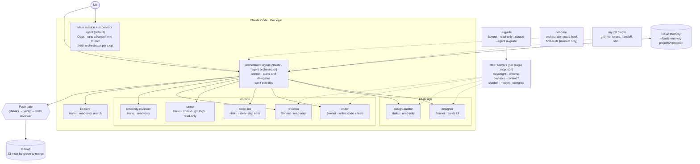
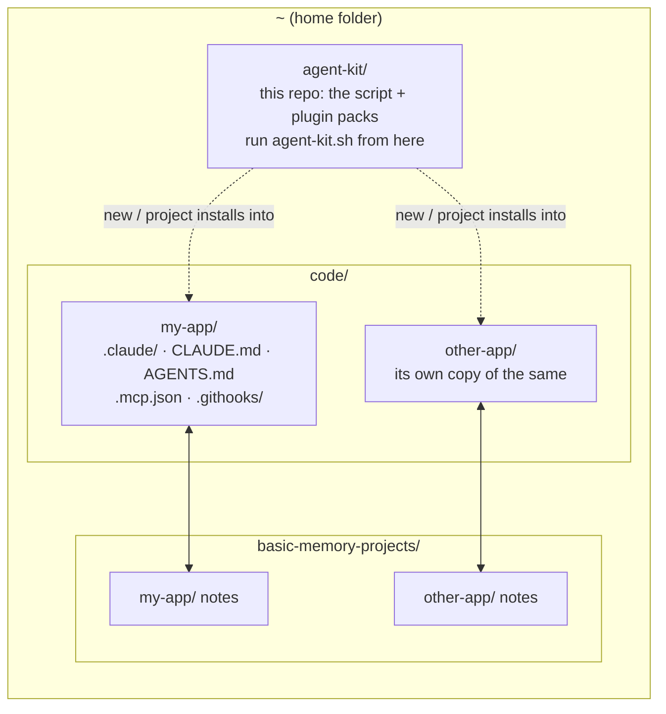
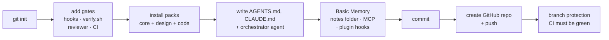
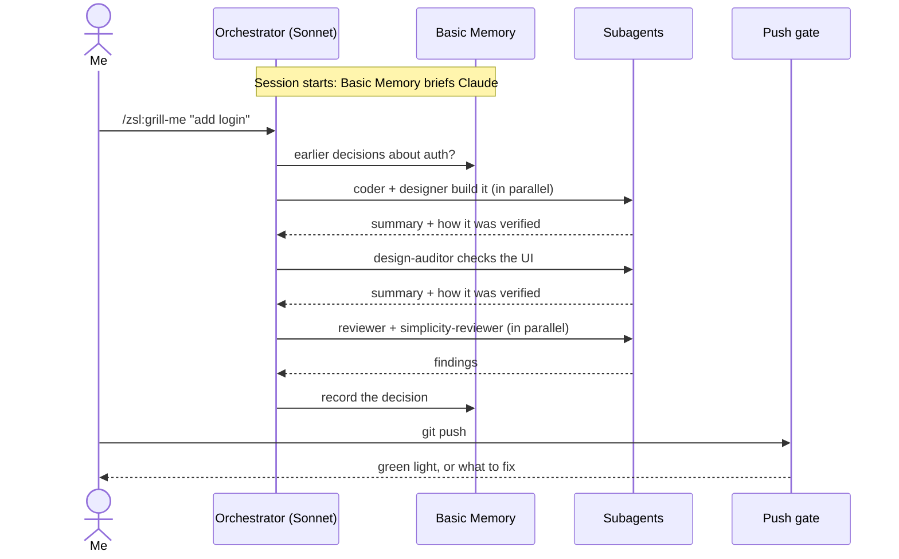
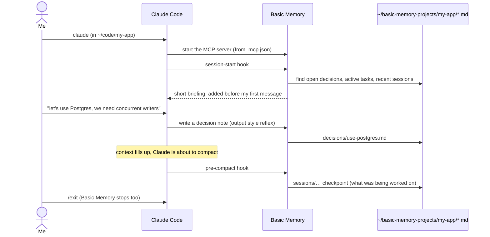
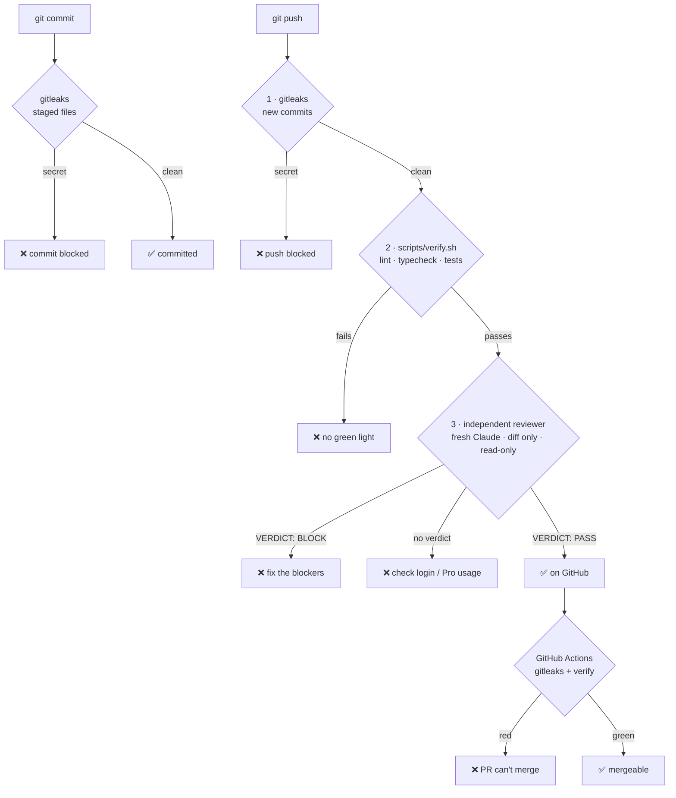

# agent-kit

My personal Claude Code setup. One script, `agent-kit.sh`, turns any folder into a project that:

- runs entirely on my **Claude Pro** login (no API key, no other AI accounts)
- starts every session as an **Opus `supervisor`** that runs a whole handoff step by step, with a fresh **Sonnet `orchestrator`** for each step. For plain interactive work, `claude --agent orchestrator` gives a **Sonnet orchestrator** (model `sonnet`) that hands the work to cheaper **subagents** (Haiku, and Sonnet for the bigger jobs). It can't edit files itself, so it has to delegate. An **Opus `lead`** is one command away for handoffs and stuck problems
- **remembers** decisions between sessions with Basic Memory
- can't push code that leaks a secret, fails its tests, or fails an **independent review**

This repo is also a Claude Code plugin marketplace. The `plugins/` folder holds the three packs the script installs.

---

## What's new in 0.9

- **`supervisor` (Opus).** Runs a handoff document end to end without check-ins: `claude --agent supervisor "run docs/handoff/<file>.md"`. It writes a run file (`docs/handoff/runs/<slug>.md`: steps, limits, decisions) and spawns a **fresh `orchestrator` subagent for each step**, so every step starts with a clean context (the same effect as `/clear`). Continue an interrupted run with `resume docs/handoff/runs/<slug>.md`. The default agent in `settings.json` is now the supervisor; plain work runs with `claude --agent orchestrator`.
- It waits for you only on a stop condition: an action the handoff does not authorise (push, PR, merge, delete, publish, install, off-limits files), a scope change, a step that fails twice, a secret it needs, or Basic Memory being unavailable. It never skips a gate (`--no-verify`, `SKIP_REVIEW`, `SKIP_VERIFY`).
- The orchestrator has a "supervised" mode: it finishes the whole step, commits locally (never pushes, unless the limits say otherwise) and returns a short report. Unsupervised, it completes every task in the request without pausing and mentions `/zsl:handoff` + `/clear` once, at the end.
- The guard now keys on `agent_type` alone: orchestrator rules apply to the main session and to orchestrator subagents. `supervisor` can Write only `docs/handoff/runs/<name>.md`. Nesting needs Claude Code >= 2.1.219 (`CLAUDE_CODE_MAX_SUBAGENT_SPAWN_DEPTH`, default 3). The `agent_type` a subagent reports is assumed to be `orchestrator`; it is not verified yet.
- The CLAUDE.md block no longer says "Between tasks, /handoff, /clear"; it gains a supervisor routing line.

### Starting a supervised run without prompts

A run that stops at every permission prompt is not unattended. The supported options (see [permission modes](https://code.claude.com/docs/en/permission-modes) and [permissions](https://code.claude.com/docs/en/permissions)), safest first:

1. **A `permissions.allow` list** in the project's `.claude/settings.json` (or `settings.local.json`) naming the commands the run needs (for example `Bash(git status:*)`, `Bash(git commit:*)`, `Bash(tests/*)`), plus `claude --permission-mode dontAsk "..."` (`claude --agent supervisor --permission-mode dontAsk "run docs/handoff/<file>.md"`). In `dontAsk` anything not pre-approved is denied instead of prompting, so the run cannot do more than the list allows.
2. `--permission-mode acceptEdits` auto-accepts file edits in the working directory; shell commands still prompt unless allowed.
3. `--permission-mode bypassPermissions` skips every prompt. It is your own opt-in choice for a throwaway or sandboxed environment. The kit does not enable it and `agent-kit.sh` never writes it into settings. The guard hook still runs in this mode.

---

## What's new in 0.7

- **`agent-kit.sh ensure <path> [design] [code] [--json]`**: an unattended, idempotent installer/updater for CI, containers and other agents. See [Unattended installs](#unattended-installs-ensure).
- Kit agents get **Basic Memory tools by full name** (`mcp__basic-memory__bm_*`) on top of their explicit `tools:` lists: coder and designer can read and write, every other agent is read-only. The lists live in one place at the top of `agent-kit.sh` (`BM_READ_TOOLS`, `BM_WRITE_TOOLS`, `BM_WRITER_AGENTS`).
- `doctor` shows whether `basic-memory` is registered and connected (read-only).
- The CLAUDE.md block (`project` and `ensure`) now starts with a Basic Memory rule: search first, and stop if the server is unavailable.
- `web-design-guidelines` is pinned by its own `WDG_REF` (currently the same commit as `AGENT_SKILLS_SHA`).

---

## Editing the kit with the kit (`self`)

```
./agent-kit.sh self [--no-design|--no-ui] [--no-code] [--no-memory]
```

Wires this repo to itself so its orchestrator session can improve the kit through its own agents. It points the `agent-kit` marketplace at this checkout (a directory marketplace; it replaces a GitHub source or another clone such as `~/agent-kit`), then runs `project` on the kit root. Because the packs load in place from `plugins/`, an agent's edit there takes effect after `/reload-plugins` or a restart. `project`, `new`, `repo` and `ensure` still refuse the kit folder, and `self` only ever accepts the kit root, never a folder inside it.

In the kit, the generated orchestrator gets a "This repo is the kit" section: plugin changes go through the coder like any other code, need a `KIT_VERSION` bump, and are checked by the runner with the offline tests. After review it may run `./agent-kit.sh self` on its own to regenerate `.claude/agents/` (the one install command it may run without asking), and it never hand-edits generated files. If a broken guard or agent file locks the orchestrator out, fix it with `claude --agent solo`.

Repointing the marketplace is user-wide, and directory plugins load in place, so **every project** loads this checkout's `plugins/` from its next session on, unfinished edits included. Do risky plugin work on a branch and switch back to `main` before working in other projects. To undo the repoint, run `claude plugin marketplace add <previous folder>`.

---

## Unattended installs (`ensure`)

```
./agent-kit.sh ensure <path> [design] [code] [--json]
```

Makes one existing git repo match the packs you list, and does nothing if it already does. `kit-core` is always on; `design` and `code` are the complete set of extra packs, so a pack you leave out is uninstalled (`kit-design`/`kit-code` only, never `kit-core`; its dependency plugins such as hallmark stay, because `--prune` also removed `kit-core`'s own dependency in testing). `<path>` must be the root of an existing git working tree (it has a `.git`); `ensure` never creates it and never runs git against it.

**It writes only:**

- `<path>/.claude/settings.json`: only the keys `extraKnownMarketplaces` and `enabledPlugins`. Everything else is untouched; the file is rewritten (2-space JSON, key order kept, trailing newline) only when one of those keys needs to change.
- `<path>/.claude/skills/web-design-guidelines/`: present only when `design` is wanted. Fetched at exactly `WDG_REF` (a commit SHA in `agent-kit.sh`, recorded in the manifest and in [VENDORED.md](VENDORED.md)); no network when the manifest already has that ref and the folder exists. A different `WDG_REF` replaces the folder. The folder holds a `.gitignore` containing `*`, because upstream ships no licence file, so it never shows up in `git status`.
- `<path>/.claude/agent-kit.json`: manifest `{kit, kit_repo, kit_version, packs, web_design_guidelines_ref}`, no timestamps.
- `<path>/CLAUDE.md`: only between `<!-- agent-kit:start -->` and `<!-- agent-kit:end -->`, rewritten each run (appended if the markers are missing, file created if missing, written only if it differs). The first line is the Basic Memory rule, then the notes convention (`repos/<repo-name>/`, `shared/`), then the routing note for the packs. The orchestrator and ui-guide lines appear only if those agent files exist (`project` writes them; `ensure` does not).
- `~/.claude`, through `claude plugin ...` commands (project scope, all with `-y`).

It never touches `.mcp.json`, `mcpServers` or `claude mcp` (except reading `claude mcp list` to report `memory`).

**Flow:** register the marketplaces the wanted packs depend on (read from the kit's `marketplace.json`; exact-name match against `claude plugin marketplace list --json`, so `agent-kit-old` never counts as `agent-kit`) and the kit's own, update them, then `claude plugin update` each wanted pack already installed at project scope in this repo or `install` it, and `uninstall` an unwanted `kit-design`/`kit-code`. The kit marketplace is named by `.claude-plugin/marketplace.json` (not `KIT_NAME`). If it is registered from another folder, `ensure` points it at the kit it is running from. Only the marketplaces a pack needs are cloned, so a code-only repo does not clone hallmark. `KIT_REPO` comes from the environment, else from the kit's own `origin` remote (`git@github.com:o/r.git` and `https://github.com/o/r.git` both give `o/r`); both `KIT_REPO` and `KIT_NAME` may be unset. `METHOD` has no effect on `ensure`: the methodology dependency is whatever the kit's plugins were generated with.

**Exit codes**

| Code | Meaning |
|---|---|
| 0 | Success, whether anything changed or not |
| 2 | Unknown argument, or `<path>` missing / not a directory / not a git working tree / inside the kit. Nothing is written |
| 3 | `claude`, `git` or `python3` is missing |
| 4 | Marketplace register or update failed |
| 5 | `claude plugin install`/`update`/`uninstall` failed |
| 6 | A project file could not be written (including a fetch failure for `web-design-guidelines`, and a `settings.json` that is not valid JSON) |

**`--json`:** all progress goes to stderr and the last stdout line is exactly one JSON object:

```
{"ok":true,"changed":false,"kit_version":"0.7.0","installed":[],"updated":[],"removed":[],"files":[],"memory":"connected"}
```

`changed` is true when a hash of the files above differs before and after the run (so it stays honest if a `claude` command rewrites `settings.json`). `files` lists the changed paths relative to the repo. `installed`, `updated` (a pack whose version or commit really moved) and `removed` are pack names. `memory` is `connected` or `missing` (not registered, or not connected); it is a warning only and `ensure` still exits 0. On failure under `--json`, the single stdout line is `{"ok":false,"code":N,"error":"..."}`.

**Unattended notes:** no TTY needed; stdin is never read (children get `</dev/null`) and every `claude plugin` command gets `-y`. Scratch files go to `${TMPDIR:-/tmp}`. Colour is used only when stdout is a terminal and `NO_COLOR` is unset. Needs network and a working `claude plugin` for the marketplaces; a repeat run still contacts the marketplaces to update them, but fetches nothing else. This Claude Code (2.1.317) has `--json` on `claude plugin list` and `claude plugin marketplace list`; on an older one without it, `ensure` fails with exit 4/5 rather than guessing from the table.

`project` is not an alias for `ensure`: it also writes `AGENTS.md`, `.mcp.json`, the Basic Memory project, the orchestrator and ui-guide agents, `.gitignore` entries and the planning plugins, none of which `ensure` may touch. It shares the CLAUDE.md block code with `ensure`.

---

## What's new in 0.6

- **Vercel agent skills** (`vercel-labs/agent-skills`, pinned). React skills are installed for projects that depend on `react` or `next`; `writing-guidelines` is fetched into every project and used by the reviewer. Left out: vercel-optimize, deploy-to-vercel, vercel-cli-with-tokens. Pin details are in [VENDORED.md](VENDORED.md) and [SECURITY-REVIEW.md](SECURITY-REVIEW.md).

---

## What's new in 0.5

Less Opus, more Sonnet and Haiku. In my transcripts the Opus orchestrator was about half the spend, mostly re-reading context each turn and running routine Bash.

- **Orchestrator on Sonnet.** The agent file sets `model: sonnet` and `effort: medium`; the supervisor sets `model: opus`. `project` no longer writes `"model"` into `.claude/settings.json` (a `--agent` session takes the agent's model, and a second setting could conflict; it removes the `sonnet`/`opusplan` values older kits wrote). Docs: https://code.claude.com/docs/en/sub-agents and https://code.claude.com/docs/en/model-config.
- **`lead` (Opus).** The Opus agent for the turns that need it: writing handoffs and getting unstuck when a problem keeps failing. Start it with `claude --agent lead`, or switch the current session with `/model opus`.
- **`kit-code:runner` (Haiku, read-only)** runs checks, tests and git status/diff/log and digs through logs, reporting pass/fail with failing test names and `file:line`, never full output.
- **`kit-code:coder-lite` (Haiku)** does clear-step work in up to about three files: renames, doc/copy/config tweaks, tests that copy a pattern, and bug fixes with a known cause. It bounces design decisions and multi-module changes to the coder.
- **`design-auditor` moved to Haiku.**
- **Haiku `Explore` at user level.** `register` writes `~/.claude/agents/Explore.md` unless you already have your own (no agent-kit marker; a dangling symlink counts as yours).
- **`--no-ui`** is an alias for `--no-design`: no kit-design, Hallmark, Design and Refine, designer or design-auditor. The default is unchanged.
- **`./agent-kit.sh usage [--since YYYY-MM-DD]`** prints tokens and estimated dollars per model family and per agent type from `~/.claude/projects`.
- `project` sets `"model": "sonnet"` only if `.claude/settings.json` has no `model` yet; your own choice is left alone.
- The orchestrator suggests `/compact` or a handoff when a session passes about 120k tokens. To pick this up in an existing project, re-run `./agent-kit.sh project <path>`.

---

## What's new in 0.4

- **Six MCP servers**, each pinned to a version (see [SECURITY-REVIEW.md](SECURITY-REVIEW.md) for the pins) and shipped in its plugin's `.mcp.json`. An agent only gets a server if its `tools:` line names it.
  - `playwright` and `chrome-devtools`: designer, design-auditor (coder gets playwright only).
  - `context7` (current library docs): designer, coder, reviewer.
  - `shadcn`: designer. `motion`: designer. Motion is a hosted service that can't be pinned, so its output is untrusted and nothing it suggests gets installed automatically.
  - `semgrep` (`semgrep mcp`): reviewer.
  - `ui-guide` gets shadcn, motion, context7, playwright and chrome-devtools. The orchestrator gets none.
- **Code intelligence.** `typescript-lsp` and `pyright-lsp` are installed per project when it has a `package.json`/`tsconfig.json` or `requirements.txt`/`pyproject.toml`.
- **Design skills.** Taste is part of `kit-design`. The GSAP skills are added only when the project depends on `gsap`. A new `ui-references` skill lists animation and design reference sites and the rules for borrowing from them. Impeccable is left out on purpose: its always-on hooks download and run a native binary. Figma and frontend-design were not added.
- **`claude --agent ui-guide`** is a read-only session for questions about the UI skills. Try "Which skill should I use to add a page-transition animation?" or "What does the Taste skill say about spacing, and does this component follow it?".
- **Security vetting.** `./agent-kit.sh vet <path|owner/repo>` scans a skill or plugin before it goes in. [SECURITY-REVIEW.md](SECURITY-REVIEW.md) records what was checked. Upstream plugins are pinned by `sha` through this kit's own `marketplace.json`.
- **0.4.1 fixes.** The shadcn server failed with `sh: 1: shadcn: not found`: a first-run npx download that was cut off left a half-installed cache entry with no command in it. A slow first download could also time out context7. `setup` now removes broken entries and pre-fetches all pinned npx servers.

---

## How it fits together



| Piece | What it is | Where it lives |
|---|---|---|
| **Main session** | The Claude Code session I talk to. It runs as the `supervisor` agent by default (Opus; runs handoff docs step by step). Plain work runs as the `orchestrator` agent (`claude --agent orchestrator`): it plans and hands work to subagents, and has no tools to edit files. | `.claude/agents/orchestrator.md` in each project |
| **Subagents** | Specialists with their own instructions, tools and model. Each starts with a clean context, so they're cheap. | `plugins/kit-*/agents/*.md` |
| **MCP servers** | Tools agents call: a headless browser (playwright, chrome-devtools), current library docs (context7), shadcn and Motion docs, Semgrep. Each plugin ships its own in `.mcp.json`; an agent gets one only if its `tools:` line names it (`mcp__plugin_<plugin>_<server>__*`). The orchestrator gets none. | `plugins/kit-*/.mcp.json` |
| **Skills** | Reusable know-how (how to do TDD, how to use shadcn…). Only the one-line description loads until a skill is used. | the plugins and their dependencies |
| **ui-guide** | A read-only session for questions about the UI skills (which one fits, what it says, how it applies to this code). Written when the design pack is on. Start it with `claude --agent ui-guide`. | `.claude/agents/ui-guide.md` in each project |
| **Packs** | `kit-core`, `kit-design` and `kit-code`. All three by default; `--no-design` / `--no-code` leave one out. | installed per project |
| **AGENTS.md / CLAUDE.md** | The project's rules. `CLAUDE.md` imports `AGENTS.md` and adds a short note on which agent to use for what. | in each project |
| **Basic Memory** | Long-term memory: plain Markdown notes Claude reads and writes through an MCP server. | `~/basic-memory-projects/<project>` |
| **Push gate** | Git hooks plus GitHub Actions that block bad pushes and merges. | `.githooks/`, `scripts/`, `.github/` |

---

## One-time setup (per machine)

1. **Get the kit and install everything it needs.** `setup` installs git, Python, Claude Code, gitleaks, uv (for Basic Memory), the GitHub CLI and Node with Homebrew on macOS or apt/dnf on Linux and WSL. It skips anything already installed and upgrades a gitleaks that's too old.

   ```bash
   git clone https://github.com/milosanokklis-debug/new_ai_setup ~/agent-kit
   cd ~/agent-kit
   ./agent-kit.sh setup
   ```

   `setup` also installs semgrep, the TypeScript and Python language servers (npm versions pinned in `agent-kit.sh`, installed with `--ignore-scripts`), the Chromium for the pinned Playwright MCP server, and pre-fetches the pinned npx MCP servers (playwright, chrome-devtools, context7, shadcn) so the first session doesn't time out. It warns if Chrome is missing or Node is older than 20.19.

   On a Mac without Homebrew, `setup` stops and prints the one-line Homebrew install command. If it says to add `~/.local/bin` to my PATH, I add that line to `~/.zshrc` and open a new terminal.

2. **Sign in with my Pro plan, not an API key.**

   ```bash
   unset ANTHROPIC_API_KEY      # also remove it from ~/.zshrc if it's there
   claude                       # log in with my claude.ai account, then type /status to confirm
   gh auth login                # so the script can create GitHub repos
   ```

   If `ANTHROPIC_API_KEY` is set, Claude Code uses it instead of Pro and bills the API. `setup` warns me if it's set.

3. **Register the marketplaces:**

   ```bash
   ./agent-kit.sh register .
   echo 'export KIT_REPO=milosanokklis-debug/new_ai_setup' >> ~/.zshrc
   ```

   Registering only adds catalogs. Nothing loads into Claude until a project installs a pack.

---

## Where things live

Projects go **next to** the kit, never inside it. The script refuses to create a project inside the kit folder.



**Always start Claude inside the project's folder** (`cd ~/code/my-app && claude`). Which agents, skills, rules and Basic Memory notes Claude uses is decided by the folder it starts in. Started from the kit folder or my home folder, Claude has none of the project's setup.

Having lots of projects doesn't cost context. Claude Code reads files only when it needs them, and each project only sees its own packs and its own notes.

---

## Starting a new project

```bash
./agent-kit.sh new ~/code/my-app                      # private GitHub repo, all packs
./agent-kit.sh new ~/code/my-app --public             # public (needed for branch protection on a free plan)
./agent-kit.sh new ~/code/my-app --no-github          # local only, push later with: ./agent-kit.sh repo ~/code/my-app
```

Every pack goes in by default. I learned this the hard way: my first website project only got `kit-core`, so the designer agents didn't exist and nothing touched the UI properly. Add `--no-design` (or `--no-ui`) only for projects with truly no UI, and `--no-code` only for projects with no code (that also turns off the orchestrator, since there's no coder to delegate to).



Then:

```bash
cd ~/code/my-app && claude
```

The first time, Claude Code asks me to approve the `basic-memory` server. I say yes. From then on it starts by itself every session.

`project` also installs, only when the project calls for them: `typescript-lsp` (a `package.json` or `tsconfig.json` in the root or up to two folders down), `pyright-lsp` (`requirements.txt` or `pyproject.toml`), the React skills (a `package.json` that depends on `react` or `next`), and the GSAP skills (a `package.json` that depends on `gsap`; design pack only). The other upstream marketplaces are listed in `UPSTREAM_MARKETPLACES` in `agent-kit.sh`. Taste, the React skills, the GSAP skills and the two language-server plugins are not added as marketplaces: they are entries in this kit's own `marketplace.json`, each pinned by `sha` to the commit vetted in `SECURITY-REVIEW.md` (see its Pins section). Install them as `<name>@agent-kit`.

To add the kit to a project that already exists, use `./agent-kit.sh project <path>` (no repo changes), or `./agent-kit.sh repo <path>` to add only the gates.

**Updating an older project:** run `./agent-kit.sh project <path>` again. It updates the packs, writes the orchestrator, turns off Matt Pocock's skills if my zsl plugin is there, and rewrites the kit's block in `CLAUDE.md` (only the part between the `agent-kit` markers; my own notes stay).

---

## Working day to day



- **Start a feature** with `/zsl:grill-me` (small) or `/zsl:to-prd` (big). Claude asks questions until the plan is clear.
- **The orchestrator delegates, always.** Plain work runs as the `orchestrator` agent (`claude --agent orchestrator`; the default session is the `supervisor`, set by `"agent": "supervisor"` in `.claude/settings.json`). The orchestrator has no Edit/Write tools, can only spawn the kit's agents (never the built-in general-purpose one), and a hook in `kit-core` blocks Bash commands that write files (`sed -i`, `>` redirects, `tee`, Python/Node scripts that write). Anything users see goes to the designer, and the design-auditor checks it afterwards.
- **Small fix, don't want the ceremony?** `claude --agent solo` gives a normal hands-on session with every tool. The guard applies to the orchestrator and the supervisor.
- **Between tasks:** `/zsl:handoff`, then `/clear`. My usage panel said most of my usage came from not clearing between tasks.
- **Never let Claude install skills on its own.** `find-skills` is manual-only. Use it to shop, then add the good ones to the kit.

---

## Basic Memory

Claude forgets everything when a session ends. Basic Memory gives each project a notebook that survives: a folder of plain Markdown notes Claude can search, read and write. Notes carry a type (`decision`, `task`, `session`…) and a status (`open`, `active`…), so Claude can pull up exactly "the open decisions" instead of guessing.

### When it runs

Nothing runs in the background. Every time I start `claude` in a project folder, Claude Code starts Basic Memory for that session and stops it when I quit. Starting it automatically is built in. The only manual step is approving the server the first time I open each project.



### What happens at each step

| When | What Basic Memory does | Why it matters |
|---|---|---|
| **Session starts** | A hook adds a short briefing before my first message: open decisions, active tasks, recent checkpoints. | The session starts knowing where things stand instead of cold. |
| **While working** | Claude searches notes before answering "what did we decide…" questions, and writes a `decision` note when I make a real choice (the `basic-memory` output style). The AGENTS.md rule backs this up. | Decisions get recorded as they happen, with the reason. |
| **Before compaction** | When the conversation gets too long, Claude Code summarizes it to make room. Right before that, a hook saves a `session` checkpoint note. | The detail that compaction throws away is kept, and the next session's briefing picks it up. |
| **Next session** | The briefing includes the new decisions and the last checkpoint. | Continuity across days without re-explaining. |

The briefing only lists notes with `type` and `status` set. That's why decisions and checkpoints use those fields, and why the briefing is short (a few hundred tokens), not a dump of every note.

### What the script sets up

All of this happens in `new` and `project`. Skip it with `--no-memory`.

| Part | What it does | Where |
|---|---|---|
| uv + the `basic-memory` command | Runs Basic Memory. The plugin's hooks look for the command on PATH. | system, `~/.local/bin` |
| A Basic Memory project | One notes folder per code project, so projects never see each other's notes. | `~/basic-memory-projects/<project>` (change with `BM_HOME`; not inside `~/basic-memory`, which is Basic Memory's own default project) |
| MCP server | Gives Claude the note tools, locked to this project's notes. Started by Claude Code each session. | `.mcp.json` (committed) |
| Basic Memory plugin | The session-start and pre-compact hooks, plus the `/basic-memory:bm-*` commands. | `.claude/settings.json` (committed) |
| `primaryProject` setting | Tells the hooks which notes to brief from and save checkpoints into. Without it, nothing is saved automatically. | `.claude/settings.json` |
| `outputStyle: basic-memory` | The "search first, record decisions" habits. About 700 tokens per turn. Remove the line to turn it off. | `.claude/settings.json` |
| Rule in AGENTS.md | "Search Basic Memory before starting; record new decisions when done." | `AGENTS.md` |

### Commands

| Command | Use it to |
|---|---|
| `/basic-memory:bm-remember <text>` | Save a quick fact or reminder |
| `/basic-memory:bm-decide` | Record a decision properly: why, alternatives, consequences |
| `/basic-memory:bm-checkpoint` | Save where I am before stopping (pairs well with `/zsl:handoff`) |
| `/basic-memory:bm-orient` | Have Claude read the notes and summarize where things stand |
| `/basic-memory:bm-status` | Check it's connected and which notes it's using |
| `/basic-memory:bm-setup` | Optional: a short interview that tunes folders and note templates |

I can also just say "remember that…" or "what did we decide about auth?".

### Good to know

- The notes are ordinary Markdown. I can open `~/basic-memory-projects/<project>` in Obsidian or any editor to read or fix them, and Claude sees the changes.
- They live **outside** the repo on purpose. They're my working memory, not project code, and they never get pushed. To use them on another machine, copy that folder, or use Basic Memory Cloud.
- From the terminal: `basic-memory project list`, `basic-memory tail --project my-app`.
- If the briefing is missing, run `/basic-memory:bm-status`. Usually the server wasn't approved yet, or `basic-memory` isn't on PATH (run `./agent-kit.sh setup`).

---

## The push gate



**Why the reviewer has no buy-in:** it's a brand-new Claude process each push. It never saw the plan, the conversation, or my commit messages (the author's framing). It's also cut off from the project's plugins, hooks, MCP servers and skills, so the Basic Memory briefing never reaches it and it never writes notes. It sees only the diff. It can read files for context but not change them, and it can't read `.env`, `.pem` or `.key` files. It only blocks for real problems: bugs that break things, data loss, leaked secrets, security holes.

Only the reviewer's final line counts (`VERDICT: PASS` or `VERDICT: BLOCK`). Anything else, including no answer at all, stops the push.

**Green light** means `scripts/verify.sh` passes. It guesses the stack (npm, pytest, cargo, go). I should replace the guesses with the project's real commands as it grows.

**Saving Pro usage:** docs-only pushes (`.md`, `.txt`, `docs/`) skip the review. Agent instructions don't count as docs: changes to `CLAUDE.md`, `AGENTS.md`, `.claude/`, `.githooks/`, `scripts/` or `.github/` are always reviewed. A commit that already passed isn't reviewed again. A very large diff gets a partial review that isn't cached. Set `REVIEW_MODEL=haiku` for cheaper reviews when I'm near my limits.

**Escape hatches** (use rarely; Claude is told never to use them unless I say so):

| I want to… | Run |
|---|---|
| skip the review once | `SKIP_REVIEW=1 git push` |
| skip tests once | `SKIP_VERIFY=1 git push` |
| skip every check once | `git push --no-verify` |
| turn the reviewer off for a repo | `git config kit.reviewer off` |

**Branch protection** needs a public repo, or GitHub Pro for private repos. On a free plan with a private repo, the local hooks still gate every push. Only the "can't merge a red PR" rule is missing.

---

## Staying inside Pro limits

My Pro usage is shared between the Claude app and Claude Code, and every subagent and push review counts.

| Habit | Why it helps |
|---|---|
| Install only the packs a project needs | Every installed skill's description loads every turn. |
| Know what the MCP servers cost | Each server's tool list loads when its agent starts, so only agents that name a server pay for it (the orchestrator pays for none). `./agent-kit.sh doctor` lists the servers. Playwright and Chrome DevTools run headless. |
| Run `./agent-kit.sh doctor` now and then | Shows skills and tokens per plugin, plus duplicate skill names. The kit is about 45 skills / ~4k tokens a turn, plus the Basic Memory plugin. |
| Let subagents do the work | The orchestrator forces this. Its model is `sonnet`, so normal turns run on Sonnet, and it sends routine checks and clear-step edits to the Haiku `runner` and `coder-lite`. For handoffs and stuck problems, switch to the Opus `lead` (`claude --agent lead`, or `/model opus`). The Opus `supervisor` is low-volume: it only reads reports and a run file, and every step's real work runs in Sonnet and Haiku subagents. |
| Haiku Explore everywhere | The built-in Explore can run on Opus; `register` installs a Haiku one at user level, and `project` writes one per project. |
| Check where the spend goes | `./agent-kit.sh usage` shows the Opus share. |
| `/zsl:handoff`, then `/clear` | Long sessions get expensive and worse. The orchestrator mentions it once at the end of a final report; a supervised run gets a fresh context per step for free. |
| `REVIEW_MODEL=haiku` | Cheaper push reviews. |

Before adding any new skill or plugin, run `./agent-kit.sh vet <path|owner/repo>`, which scans it without running anything and exits non-zero on a high-severity finding or any scan that could not run (`NOT SCANNED`); `sync` runs it on every vendored skill.

The packs pull skills from a few third-party GitHub marketplaces (Addy Osmani, Hallmark, Design and Refine, Taste, the official Claude plugins marketplace for the language servers, GSAP when a project uses it, Basic Memory, and Matt Pocock only when my zsl plugin isn't there). My own skills are vendored at pinned commits (`VENDORED.md`); the upstream plugins update when their authors push. That's a trust decision. Run `doctor --scan` after updates.

---

## Troubleshooting

| Problem | Fix |
|---|---|
| "gitleaks is not installed" or "too old", and nothing will commit | `./agent-kit.sh setup` |
| A command isn't found right after `setup` | Add `export PATH="$HOME/.local/bin:$PATH"` to `~/.zshrc`, open a new terminal |
| Claude doesn't use my agents or rules | Start it inside the project folder, not the kit folder |
| Push stopped: "reviewer didn't return a verdict" | Run `claude`, type `/status`: signed in? out of Pro usage? Log in `.git/kit-review/*.err` |
| Usage billed to the API | `unset ANTHROPIC_API_KEY`, then `/status` |
| An MCP server failed to connect on first run | `./agent-kit.sh setup` (pre-fetches the servers, repairs a broken npx cache), or retry in `/mcp` |
| Basic Memory tools or briefing missing | Approve the server when asked, then `/basic-memory:bm-status`. Re-run `./agent-kit.sh setup` if `basic-memory` isn't found |
| "couldn't turn on branch protection" | Private repo on a free plan. Make it public or skip it. The hooks still work. |
| A plugin change isn't showing up | `claude plugin marketplace update agent-kit`, then restart Claude Code |
| The main session does the work itself, or never uses the designer | Re-run `./agent-kit.sh project <path>`: older projects have no orchestrator and may be missing `kit-design`. Check `"agent": "supervisor"` in `.claude/settings.json` (`orchestrator` for plain work) |
| "The orchestrator doesn't change files itself" | Working as intended. Let it delegate, or restart with `claude --agent solo` |

---

## Command reference

| Command | Does |
|---|---|
| `./agent-kit.sh setup` | Install every tool the kit needs (safe to re-run) |
| `./agent-kit.sh new <path> [--no-design\|--no-ui] [--no-code]` | Everything: repo, gates, packs, Basic Memory, GitHub. Installs missing tools first |
| `./agent-kit.sh project <path> [--no-design\|--no-ui] [--no-code]` | Packs, orchestrator, AGENTS.md/CLAUDE.md and Basic Memory only. Re-run it to update an older project. `--no-ui` is an alias for `--no-design` |
| `./agent-kit.sh ensure <path> [design] [code] [--json]` | Unattended, idempotent install/update of the packs into one existing git repo; see [Unattended installs](#unattended-installs-ensure) |
| `./agent-kit.sh repo <path>` | Gates and GitHub only |
| `./agent-kit.sh doctor [--scan]` | What's installed, which MCP servers the kit ships, and what the skills cost per turn |
| `./agent-kit.sh usage [--since YYYY-MM-DD]` | Tokens and estimated $ per model family and agent type, from `~/.claude/projects` (list prices; an estimate, not your bill) |
| `./agent-kit.sh vet <path\|owner/repo>` | Security-check a skill or plugin before installing it; non-zero exit on high-severity findings |
| `./tests/skills.sh` | Check every kit skill has valid name/description frontmatter; own skills must stay under 500 lines |
| `./tests/vet.sh` | Check that `vet` fails a bad fixture (zero-width space, `curl \| sh`) and passes a clean one |
| `./agent-kit.sh sync .` | Re-pull vendored skills from upstream (see `VENDORED.md`), then vet each one |
| `./agent-kit.sh register .` | Add the marketplaces to Claude Code (once per machine), and install the Haiku `Explore` agent in `~/.claude/agents/` (skipped if you have your own, i.e. no agent-kit marker) |

Flags for `new`/`project`: `--no-memory` (skip Basic Memory), `--graph` (code graph for big repos). Flags for `new`/`repo`: `--public`, `--no-github`, `--name NAME`.
Environment variables: `KIT_REPO`, `REVIEW_MODEL`, `BM_HOME`, `METHOD=agent-skills|superpowers` (no effect on `ensure`), `NO_COLOR`, `PLANNING=zsl|mattpocock` (default: zsl when that plugin is loaded).
